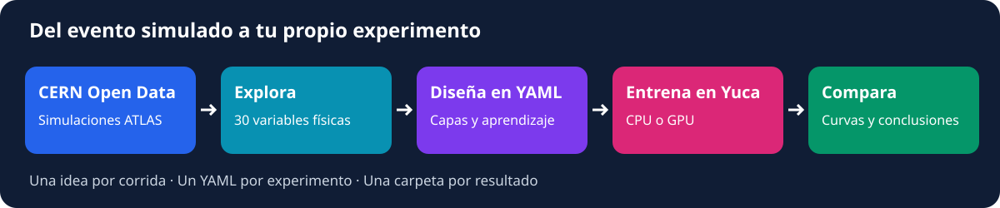
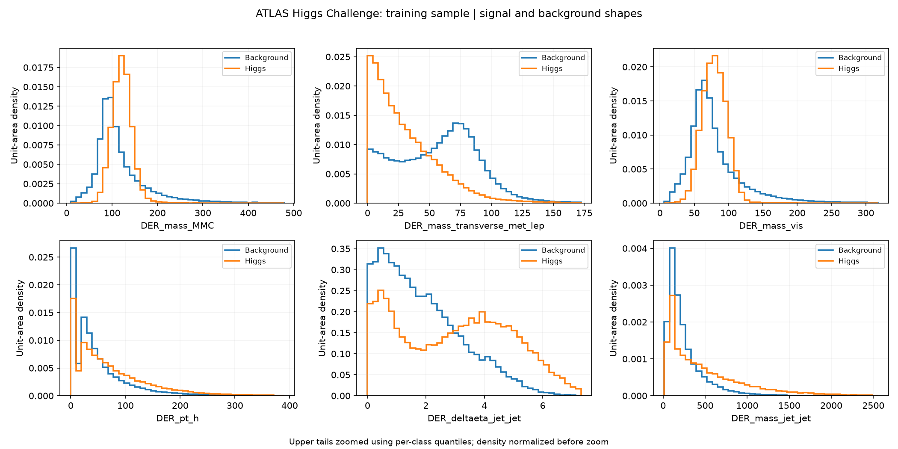

# ATLAS Higgs Challenge: tu primer laboratorio de redes neuronales

**¿Puede una red reconocer eventos compatibles con un Higgs?** En esta práctica explorarás datos abiertos de ATLAS y probarás tus propias redes en Yuca.

<div class="grid cards" markdown>

- **Una pregunta de física**

    Separar Higgs → ττ de procesos que producen señales parecidas en el detector.

- **30 variables por evento**

    Masas, momentos, jets y energía faltante. La red combina esa información.

- **Tú decides desde un YAML**

    Número de capas, neuronas, aprendizaje, dropout y duración del entrenamiento.

- **Un experimento, una carpeta**

    Conserva cada configuración y sus resultados para compararlos después.

</div>



## 1. Conoce el reto y sus muestras

El [Higgs Challenge de ATLAS](https://opendata.cern.ch/record/328) fue una competición para identificar eventos simulados de Higgs. Estudia el decaimiento **H → ττ**, con un tau que produce un electrón o muón y otro que produce hadrones. También aparecen neutrinos, que no se detectan directamente.

| Muestra | ¿Qué representa? | ¿Por qué interesa? |
| --- | --- | --- |
| **Señal: Higgs → ττ** | El proceso que queremos identificar | La red debería asignarle una puntuación alta |
| **Fondo: Z → ττ** | Otro bosón que también produce taus | Se parece mucho a la señal |
| **Fondo: pares de top** | Procesos con partículas top | Pueden producir objetos similares |
| **Fondo: W + jets** | Eventos donde la identificación puede confundir un jet con un tau | También pueden imitar la señal |

En el archivo, la etiqueta distingue señal (`s`) y fondo (`b`); no entrenaremos un clasificador separado para cada fondo.

El archivo completo tiene **818 238 eventos**. Para practicar usamos los **250 000 eventos de la partición original de entrenamiento**: 200 000 para aprender y 50 000 para comprobar el progreso. Los eventos reservados para la evaluación final permanecen fuera del ajuste.

!!! info "¿De dónde vienen los datos?"
    [Página oficial y descripción de variables](https://opendata.cern.ch/record/328) · [Archivo original](https://opendata.cern.ch/record/328/files/atlas-higgs-challenge-2014-v2.csv.gz)

    **En el taller ya están descargados en la carpeta compartida.** Tú no necesitas descargarlos. Este ejemplo empieza con una tabla de variables extraídas de simulaciones ATLAS. El autoencoder complementario muestra el recorrido desde NanoAOD de CMS.

### ¿Qué le vamos a dar a la red?

| Ejemplo de variable | Idea física |
| --- | --- |
| `DER_mass_MMC` | Una estimación de la masa del sistema de dos taus |
| `DER_mass_vis` | Masa de los productos visibles del tau y del leptón |
| `PRI_tau_pt` | Momento transversal del tau hadrónico reconstruido |
| `PRI_met` | Energía transversal faltante, relacionada con partículas no detectadas |
| `PRI_jet_num` | Número de jets registrado en el evento |
| `DER_deltaeta_jet_jet` | Separación entre los dos jets en la dirección del haz |

La red recibe números de este tipo y aprende a combinarlos. Las etiquetas dicen qué eventos simulados son señal o fondo; los identificadores y pesos no se usan como entradas de la red.

## 2. Prepara tu YAML personal

Completa primero el [acceso a Yuca](../yuca-course/00_acceso.md) y la [configuración de tu cuenta](../yuca-course/01_entorno.md). Para esta práctica se utiliza el ambiente GPU `ml-hep-gpu`; si aún no lo tienes, sigue una sola vez la [preparación del ambiente GPU](atlas-reference.md#entorno-gpu-de-yuca).

**En la terminal**, desde tu repositorio:

```bash
cd "$HOME/ML-integration-CMSSW"
git pull --ff-only origin opendata_dev
mkdir -p "$HOME/hep-workshop/configs" "$HOME/hep-workshop/logs"
cp -n workshop/configs/atlas_higgs_gpu.yaml "$HOME/hep-workshop/configs/atlas_baseline01.yaml"
```

En **Files de Open OnDemand**, abre `hep-workshop/configs/atlas_baseline01.yaml` con el editor. Este archivo controla tu experimento. Al principio conserva la plantilla completa.

| Campo del YAML | ¿Qué puedes explorar? |
| --- | --- |
| `model.hidden_dims` | Cada número es una capa oculta y su cantidad de neuronas |
| `model.dropout` | Qué fracción de activaciones se omite al entrenar para regularizar |
| `training.learning_rate` | Tamaño de los pasos de aprendizaje |
| `training.batch_size` | Eventos que se procesan juntos |
| `training.epochs` | Máximo de pasadas por los datos de entrenamiento |
| `training.patience` | Cuántas épocas esperar sin mejora en validación antes de parar |
| `output.directory` | Carpeta personal donde se guardará esa corrida |

**Ejemplo dentro del YAML, no en la terminal:**

```yaml
model:
  hidden_dims: [128, 64, 32, 16]
  dropout: 0.1
```

Esta red tiene **cuatro capas ocultas**, con 128, 64, 32 y 16 neuronas. No necesitas modificar Python ni los scripts de envío. Conserva los campos de datos y particiones para comparar los mismos eventos.

## 3. Mira las variables antes de entrenar

Activa el ambiente y genera las comparaciones con **el mismo YAML**:

```bash
source /apps/miniconda3/etc/profile.d/conda.sh
module load rocm/6.4.3
conda activate ml-hep-gpu
python workshop/plot_atlas.py -f "$HOME/hep-workshop/configs/atlas_baseline01.yaml"
```

En Files, abre `hep-workshop/plots/atlas_inputs01/variables_01.png`. Hay cinco imágenes, con seis variables cada una, y un PDF con todas. La carpeta y el número de intervalos se controlan en el bloque `plots` del YAML. Para regenerar, elige una carpeta nueva en `plots.directory`.

Las distribuciones se normalizan a área uno para comparar formas y se amplía la zona central para que las colas largas no oculten sus diferencias. Por defecto se muestra hasta el percentil 99.5 de cada clase; `plots.upper_quantile: 1.0` permite ver el rango completo. El área se normaliza antes del recorte visual. Los valores ausentes se omiten en las gráficas; su frecuencia se guarda en `variable_summary.csv`. No representan cantidades físicas esperadas de señal y fondo.



*Ejemplo real del conjunto de entrenamiento: no se emplean eventos del conjunto privado. Los nombres y unidades de cada variable se explican en el registro oficial.*

Antes de seguir, completa la [tabla de exploración de variables](atlas-experiments.md#antes-de-entrenar-que-informacion-tenemos). ¿Dónde se parecen señal y fondo? ¿Qué variables podrían ayudar a separarlos?

## 4. Envía tu primera red a Yuca

**En la terminal**, desde la raíz del repositorio:

```bash
sbatch --output="$HOME/hep-workshop/logs/atlas_%j.out" \
  workshop/run_atlas_gpu.slurm "$HOME/hep-workshop/configs/atlas_baseline01.yaml"
squeue -u "$USER"
```

El comando solicita una GPU y ejecuta tu YAML. La cuenta del curso y el ambiente ya están definidos en el script. Si el trabajo desaparece de la cola, revisa el registro: desaparecer no garantiza éxito.

Al terminar, abre en Files:

```text
hep-workshop/results/atlas_gpu_baseline01/training_summary.png
```

| Panel | Pregunta que debes hacerte |
| --- | --- |
| Pérdidas por época | ¿Mejora en entrenamiento y también en validación? |
| Curva ROC | ¿Cuánta señal conserva para una aceptación dada de fondo? |
| Puntuación de la red | ¿Señal y fondo reciben puntuaciones distintas? |

Los números están en `metrics.json`, dentro de esa misma carpeta. **AUC:** separación global (mayor es mejor). **AMS interna:** indicador que combina señal y fondo seleccionados con sus pesos. Compara ambas; no tienen por qué mejorar juntas.

## 5. Copia, cambia y vuelve a entrenar

Tu ciclo de trabajo será siempre:

**Copiar YAML → cambiar una idea → elegir carpeta nueva → entrenar → llenar la tabla → discutir.**

Por ejemplo, para probar una red mayor:

```bash
cp -n "$HOME/hep-workshop/configs/atlas_baseline01.yaml" "$HOME/hep-workshop/configs/atlas_02.yaml"
```

Abre `atlas_02.yaml` en Files. Cambia `model.hidden_dims` a `[512, 256, 128, 64]` y, dentro del bloque `output`, cambia la carpeta:

```yaml
output:
  directory: $HOME/hep-workshop/results/atlas_02
```

Conserva el resto del archivo y guarda. **Cambiar el nombre del YAML no cambia automáticamente la carpeta de resultados.**

```bash
sbatch --output="$HOME/hep-workshop/logs/atlas_%j.out" \
  workshop/run_atlas_gpu.slurm "$HOME/hep-workshop/configs/atlas_02.yaml"
```

La carpeta nueva conservará el modelo, la copia del YAML utilizado, los números y las gráficas. Los experimentos anteriores no se sobrescriben.

| Archivo personal | Carpeta de resultados |
| --- | --- |
| `configs/atlas_baseline01.yaml` | `results/atlas_gpu_baseline01/` |
| `configs/atlas_02.yaml` | `results/atlas_02/` |
| `configs/atlas_03.yaml` | `results/atlas_03/` |

Empieza cambiando **un solo parámetro**. Después combina ideas si puedes explicar por qué lo haces.

## 6. Experimentos por grupo y discusión

Cada grupo parte de la misma referencia y registra sus propios números en la **[bitácora del taller: tablas y preguntas](atlas-experiments.md)**.

| Grupo | Primer experimento | Pregunta |
| --- | --- | --- |
| 1 | Aumentar neuronas por capa | ¿Mejora lo suficiente para justificar el costo? |
| 2 | Aumentar el número de capas | ¿Mayor profundidad ayuda o sobreajusta? |
| 3 | Cambiar dropout de 0.1 a 0.3 | ¿Cambia la distancia entre entrenamiento y validación? |
| 4 | Cambiar aprendizaje de 0.001 a 0.0003 | ¿Aprende más lentamente o llega a otro resultado? |

**Parada temprana:** para permitir una corrida más larga, conserva los demás campos y usa `epochs: 200`, `patience: 15`. Se conserva el modelo con menor pérdida de validación. No es obligatorio llegar a 200 épocas.

**CPU frente a GPU:** crea otra copia con `training.device: cpu` y una carpeta nueva. Envíala con el script CPU, que no reserva GPU:

```bash
sbatch --output="$HOME/hep-workshop/logs/atlas_cpu_%j.out" \
  workshop/run_atlas_cpu.slurm "$HOME/hep-workshop/configs/atlas_cpu01.yaml"
```

Este comando supone que ya copiaste y editaste el YAML completo con ese nombre. Usa el mismo número de épocas para comparar tiempos. El campo `fit_seconds` excluye la espera en cola y la preparación inicial. No necesitamos entrenamientos largos para aprender: las primeras corridas de Yuca tardaron decenas de segundos de cálculo.

## 7. ¿Qué entregamos y contra qué comparamos?

Cada grupo comparte su tabla, el YAML, `metrics.json`, `training_summary.png` y una conclusión breve. No es necesario entregar el modelo completo.

Los benchmarks históricos del challenge son **AMS 3.40 (MultiBoost)** y **3.81 (ganador, conjunto de redes profundas)**. Nuestra AMS interna todavía no se compara directamente con ellos: usa otra evaluación. La [bitácora](atlas-experiments.md#referencia-externa-el-challenge-original) separa los resultados del curso de esos números publicados.

Termina respondiendo: **¿qué cambiaste, qué mejoró o empeoró y cuánto tiempo costó?** Un resultado sin mejora también es un resultado útil.

[Detalles opcionales: entorno, pesos, protocolo y resultados medidos en Yuca](atlas-reference.md) · [Exploración complementaria: autoencoder CMS](autoencoder.md)
