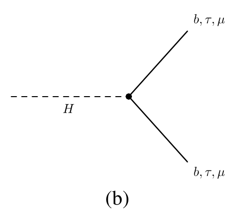

# La física detrás del Higgs Challenge

**La red no mide una sección eficaz por sí sola.** Ayuda a seleccionar eventos para que una medición o una búsqueda sea más sensible. Aquí conectamos las partículas, las 30 entradas de la red y la interpretación física de sus resultados.

[Volver al laboratorio YAML](atlas-gpu.md) · [Completar la bitácora](atlas-experiments.md)

## De la colisión a lo que ve el detector

La señal del reto es **H → τ⁺τ⁻**. Un tau decae a electrón o muón y neutrinos; el otro produce hadrones y un neutrino. Por eso buscamos **un leptón, un tau hadrónico y momento transversal faltante**, a veces acompañados de jets. El detector registra productos del decaimiento, no una etiqueta que diga «Higgs».

{ width="800" }

*Producción: (a) fusión de gluones; (b) fusión de bosones vectoriales, con quarks salientes que pueden producir jets. Recorte de la figura 1 de la [publicación conjunta ATLAS y CMS, arXiv:1606.02266](https://arxiv.org/abs/1606.02266). Estos diagramas contextualizan la producción; no proceden del artículo del challenge.*

{ width="350" }

*Decaimiento a fermiones: para esta práctica nos interesa la opción ττ. El gráfico original también etiqueta b y μ. Recorte de la figura 5(b) de la misma publicación ATLAS y CMS; no se han cambiado sus etiquetas.*

Los fondos imitan esos objetos: **Z → ττ** produce taus reales; los pares de top pueden generar leptones, taus y jets; **W + jets** puede entrar cuando un objeto se identifica incorrectamente. Una misma apariencia final puede tener distintos orígenes.

{ width="460" }

*Figura 1 extraída del [artículo del Higgs Challenge](https://proceedings.mlr.press/v42/cowa14.pdf), que reproduce el resultado ATLAS-CONF-2013-108. La línea roja de señal está multiplicada por **50**, como indica la leyenda. Esta figura publicada contiene datos y estimaciones de fondo; nuestros entrenamientos usan simulaciones del dataset. No confundir sus cantidades con las de nuestros histogramas normalizados.*

**Pregunta para el salón:** si señal y fondo pueden producir objetos similares, ¿qué combinaciones de masas, direcciones y momentos podrían ayudarnos?

## Las 30 variables, organizadas por su significado

La tabla corta de la guía solo mostraba ejemplos. **El YAML `features: all_physics` utiliza las 30 variables siguientes.** `PRI_` identifica 17 cantidades primarias y `DER_` las 13 construidas combinando otras cantidades.

### Un pequeño vocabulario

- **pT:** momento perpendicular al haz, en GeV.
- **η:** pseudorrapidez; expresa la dirección respecto al haz. Cerca de cero corresponde a la región transversal.
- **φ:** ángulo alrededor del haz, en radianes.
- **Jet:** conjunto de partículas asociado a un quark o gluón.
- **MET:** desequilibrio transversal observado; puede revelar neutrinos, aunque también depende de la resolución del detector.
- **Masa visible:** usa lo detectado; no recupera automáticamente la energía de los neutrinos.

### Objetos reconstruidos: 17 variables primarias

Definiciones resumidas del [registro oficial de datos](https://opendata.cern.ch/record/328). Los jets se ordenan por pT: «leading» es el primero, «subleading» el segundo.

| Variable | Qué representa |
| --- | --- |
| `PRI_tau_pt` | pT del tau hadrónico reconstruido |
| `PRI_tau_eta` | Su pseudorrapidez |
| `PRI_tau_phi` | Su ángulo azimutal |
| `PRI_lep_pt` | pT del electrón o muón |
| `PRI_lep_eta` | Pseudorrapidez del leptón |
| `PRI_lep_phi` | Ángulo azimutal del leptón |
| `PRI_met` | Magnitud del MET |
| `PRI_met_phi` | Dirección azimutal del MET |
| `PRI_met_sumet` | Energía transversal total registrada |
| `PRI_jet_num` | Número de jets; 3 representa tres o más |
| `PRI_jet_leading_pt` | pT del primer jet |
| `PRI_jet_leading_eta` | Pseudorrapidez del primer jet |
| `PRI_jet_leading_phi` | Ángulo azimutal del primer jet |
| `PRI_jet_subleading_pt` | pT del segundo jet |
| `PRI_jet_subleading_eta` | Pseudorrapidez del segundo jet |
| `PRI_jet_subleading_phi` | Ángulo azimutal del segundo jet |
| `PRI_jet_all_pt` | Suma escalar de pT de todos los jets |

Estas cantidades describen los objetos del evento. No esperamos que cada una discrimine por sí sola: también importan sus relaciones y las condiciones de detección.

### Combinaciones físicas: 13 variables derivadas

Resumen de la [documentación del challenge](https://opendata.cern.ch/record/329), con las definiciones detalladas en su apéndice.

| Variable | Qué combina |
| --- | --- |
| `DER_mass_MMC` | Masa ττ estimada considerando los neutrinos |
| `DER_mass_transverse_met_lep` | Masa transversal leptón–MET |
| `DER_mass_vis` | Masa del tau visible y el leptón |
| `DER_pt_h` | Suma vectorial transversal tau, leptón y MET |
| `DER_deltaeta_jet_jet` | Separación en η entre los dos jets |
| `DER_mass_jet_jet` | Masa del par de jets |
| `DER_prodeta_jet_jet` | Producto de las η de ambos jets |
| `DER_deltar_tau_lep` | Separación angular tau–leptón en η y φ |
| `DER_pt_tot` | Balance transversal: tau, leptón, MET y hasta dos jets |
| `DER_sum_pt` | Suma escalar de pT del tau, leptón y jets |
| `DER_pt_ratio_lep_tau` | Cociente pT del leptón / pT del tau |
| `DER_met_phi_centrality` | Posición angular del MET respecto a tau y leptón |
| `DER_lep_eta_centrality` | Posición del leptón en η respecto a los jets |

**Tres ideas físicas:** las masas ayudan a distinguir hipótesis de origen; el MET informa sobre componentes invisibles; los jets y sus separaciones aportan información sobre la producción. La red puede combinar estas pistas sin que nosotros fijemos todos los cortes.

Si no hay dos jets, algunas variables no están definidas. El valor `-999` lo señala: no es una masa o un momento físico. La preparación automática lo trata antes del entrenamiento. Las columnas de etiqueta, pesos, identificador y partición no cuentan entre las 30 entradas.

## Leer una ROC como físico

La red asigna una puntuación. Al exigir una puntuación mayor que cierto umbral, conservamos una fracción de señal **εs** y una fracción de fondo **εb**.

| Elemento de la ROC del taller | Significado |
| --- | --- |
| Eje horizontal | Fondo que dejamos pasar, εb |
| Eje vertical | Señal que conservamos, εs |
| Un punto | Una elección de umbral |
| Más arriba al mismo εb | Más señal para el mismo fondo aceptado |
| Más a la izquierda al mismo εs | Menos fondo para la misma señal conservada |

**AUC resume toda la curva.** Un análisis puede depender solo de una zona de bajo fondo; por eso una AUC ligeramente mayor no garantiza mejor AMS o mejor límite.

Nuestro gráfico ROC es **sin pesos**. Para traducirlo a rendimientos físicos, se deben sumar los pesos de los eventos seleccionados. Los porcentajes de eventos simulados no siempre son las eficiencias ponderadas que corresponden a tasas esperadas.

### Ejemplo para completar en clase

Este es un ejemplo hipotético de rendimientos esperados, no un resultado del dataset. Antes de la selección de la red tenemos **100 eventos de señal y 10 000 de fondo**. Ambas selecciones conservan 60% de la señal:

| Selección | εs | εb | Señal seleccionada s | Fondo seleccionado b | s / √b, aproximación |
| --- | ---: | ---: | ---: | ---: | ---: |
| A | 0.60 | 0.10 | 60 | 1 000 | 1.90 |
| B | 0.60 | 0.05 | 60 | 500 | 2.68 |

La segunda selección permite ver mejor el mismo exceso de señal sobre el fondo. **No cambia la frecuencia física con la que se produce el Higgs**; cambia cuánto ruido dejamos entrar en la selección. La aproximación s/√b sirve aquí para ilustrar el efecto con fondo dominante y conocido; no reemplaza la AMS del challenge ni un cálculo con incertidumbres sistemáticas.

## Conexión con una sección eficaz

La sección eficaz σ describe la frecuencia de producción de un proceso para una luminosidad dada. En un conteo simplificado, el número esperado de eventos seleccionados se expresa como:

<strong>s = L × σ × B × A × εs</strong>

L es la luminosidad integrada; B, la probabilidad de la cadena de decaimiento considerada; A, la aceptación y preselección previa; εs, la eficiencia adicional de nuestra red.

Si observamos N eventos y estimamos un fondo b, una estimación elemental sería:

<strong>σ estimada = (N − b) / (L × B × A × εs)</strong>

Una red útil puede reducir el fondo conservando señal y ayudar a disminuir la incertidumbre de la medición. Pero hay que conocer y calibrar εs y estimar el fondo. Una selección demasiado estricta pierde señal; una red mal modelada puede sesgar el resultado. **Mejor ROC no significa una sección eficaz medida más grande.**

## Conexión con límites y descubrimiento

Si no aparece un exceso claro, un análisis puede establecer un **límite superior**: qué intensidades de señal quedan incompatibles con los datos bajo un procedimiento estadístico definido. Una mejor separación puede mejorar el límite **esperado**, pero no garantiza un cambio concreto del límite observado.

También puede mejorar la sensibilidad esperada a un exceso. El cálculo completo utiliza un modelo estadístico, normalizaciones e incertidumbres de fondo, detector y señal; puede emplear toda la distribución de puntuaciones, no solo un corte. Una ROC no contiene por sí sola toda esa información. Véase la [referencia de Cowan, Cranmer, Gross y Vitells](https://arxiv.org/abs/1007.1727).

En este taller medimos **clasificación y AMS de validación en simulación**. No estamos publicando una sección eficaz, un límite ni una significancia observada de descubrimiento. La AMS conecta la selección con una sensibilidad aproximada, y motiva por qué no basta con acertar muchas etiquetas. El [artículo del challenge, secciones 2 y 4](https://proceedings.mlr.press/v42/cowa14.pdf), desarrolla esa conexión.

!!! question "Para cerrar la discusión"
    ¿Qué preferimos: más AUC global, más señal al mismo fondo, o menos fondo al mismo número de señales? La respuesta depende del objetivo físico y sus incertidumbres. Expliquen qué medirían antes de elegir un modelo.

## Procedencia de las imágenes

- `higgs_ggf_vbf.png`: figura 1 de ATLAS y CMS, [arXiv:1606.02266](https://arxiv.org/abs/1606.02266), recortada para mostrar los diagramas.
- `higgs_fermion_decay.png`: panel 5(b) de la misma publicación, recortado sin cambiar etiquetas.
- `challenge_visible_mass.png`: figura 1 de Adam-Bourdarios et al., [PMLR 42 (2015)](https://proceedings.mlr.press/v42/cowa14.html), con el crédito original a ATLAS-CONF-2013-108 preservado.

Los diagramas de Feynman se obtuvieron de la publicación conjunta, porque el artículo y la documentación del challenge no contienen ese tipo de diagramas. No son figuras generadas por nuestros entrenamientos.
