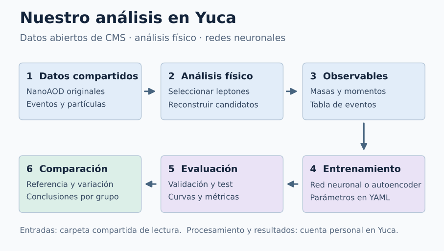

# Practical Machine Learning in HEP

Dos jornadas: miércoles de tres horas y jueves de una hora en el clúster Yuca: **clasificación de Higgs con CMS NanoAOD** y **detección de anomalías con CMS Open Data**. Cada equipo modifica un modelo, registra sus resultados y justifica una decisión física.

**Este es el curso Yuca Open Data, con el nombre Practical Machine Learning in HEP.** Es una única ruta de aprendizaje: configuración del sistema → datos abiertos → análisis de NanoAOD → extracción de observables → entrenamiento → evaluación.

## Flujo del análisis en Yuca

Los archivos de entrada se leen desde la carpeta compartida. Cada participante guarda el procesamiento y los resultados en su cuenta personal, y después comparte las figuras y métricas de su grupo.

[Descargar PNG](../assets/workshop/flujo_analisis_yuca.png) · [Descargar SVG vectorial](../assets/workshop/flujo_analisis_yuca.svg)

## Empezar aquí

1. [Primer acceso SSH y activación de la cuenta con 2FA](../yuca-course/00_acceso.md), una sola vez y preferentemente antes del taller.
2. [Clonar el repositorio, crear tu entorno conda e instalar dependencias](../yuca-course/01_entorno.md), con la cuenta ya activada.
3. [Datos abiertos, formato NanoAOD y revisión de archivos](../yuca-course/02_datos.md).
4. [Ejemplo 1: selección y reconstrucción Higgs/ZZ, observables y clasificación](higgs.md).
5. [Ejemplo 2: autoencoder CMS multileptónico](autoencoder.md).
6. [Modificaciones y bitácora de experimentos](experiments.md).
7. [Entrega en carpeta compartida y comparación colectiva](delivery.md).

No empezar ejecutando entrenamientos: comprobar primero el entorno, las rutas compartidas y la lectura de Events. Los datos del curso ya estarán disponibles en una carpeta compartida: no es necesario descargarlos. Cada participante crea su entorno conda, instala las bibliotecas, verifica la instalación y prepara su espacio personal antes de las prácticas.

## Programa: miércoles y jueves

| Jornada | Distribución del tiempo | Producto del alumno |
| --- | --- | --- |
| Miércoles, hora 1 | 20 min acceso/entorno; 10 min Events; 30 min selección y extracción | Cutflow, masas reconstruidas y referencia |
| Miércoles, hora 2 | 15 min primer entrenamiento; 25 min una variación; 10 min test final; 10 min discusión | Comparación y evaluación final Higgs |
| Miércoles, hora 3 | 10 min anomalías; 10 min datos CMS; 25 min entrenamiento; 15 min diagnóstico | Referencia de autoencoder |
| Jueves, hora 1 | 10 min repaso; 25 min una variación; 15 min comparación; 10 min presentación | Tabla y conclusiones de cada equipo |

Las colas pueden afectar los tiempos: consultar el estado de los trabajos y sus registros. La instalación inicial depende de las descargas y puede ocupar más tiempo que el previsto; completar el capítulo de configuración antes de entrar a los ejemplos. No se garantiza un tiempo de entrenamiento universal. Cada equipo realiza una mejora; los ejercicios restantes son extensiones.

## Dos preguntas físicas

1. **Supervisado:** Higgs de 125 GeV→ZZ*→4 leptones frente a ZZ→4 leptones. Ambas muestras son NanoAODv9 UL16 de CMS. El alumno realiza la selección y construye masas y momentos antes de entrenar.
2. **No supervisado:** DYJets HT 70–100, WZ y ZZ de CMS como referencia electrodébil multileptónica; W′→WZ→3ℓν como referencia de evaluación.

Son simulaciones abiertas, no etiquetas de procesos medidas en colisiones reales. La práctica usa una selección educativa simplificada, no reproduce el análisis oficial CMS. El CSV ATLAS anterior queda como extensión opcional.

## Antes de empezar

Utilizar la cuenta Slurm y las rutas compartidas anunciadas para el curso, y el entorno conda personal creado siguiendo el capítulo de configuración. Los NanoAOD Higgs/ZZ y los datos CMS del autoencoder se leen desde allí. Guardar configuraciones, variables extraídas, registros y resultados únicamente en $HOME/hep-workshop de tu propia cuenta.

Los comandos de inicio están en [Configuración del sistema](../yuca-course/01_entorno.md), que es el primer capítulo de este mismo curso. No se requiere una cuenta CERN para leer estas muestras públicas. La práctica Higgs usa uproot para leer ROOT; el flujo de referencia del framework utiliza además PyROOT.

## Ruta de aprendizaje

- [Configuración del sistema: primer paso para el alumno](../yuca-course/01_entorno.md)
- [Miércoles, horas 1 y 2: Higgs frente a fondo](higgs.md)
- [Miércoles, hora 3, y jueves: autoencoder CMS](autoencoder.md)
- [Bitácora de experimentos](experiments.md)

Código en [`workshop/`, rama opendata_dev](https://github.com/castaned/ML-integration-CMSSW/tree/opendata_dev/workshop). Uso de cómputo de alto rendimiento: clúster ACARUS de la Universidad de Sonora.
